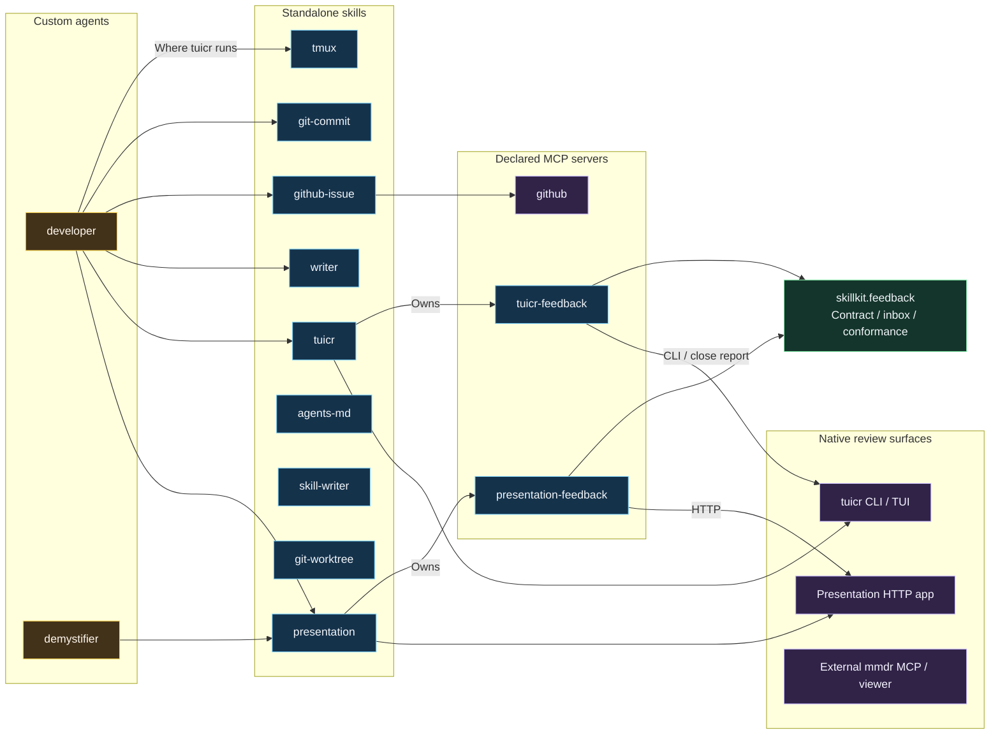
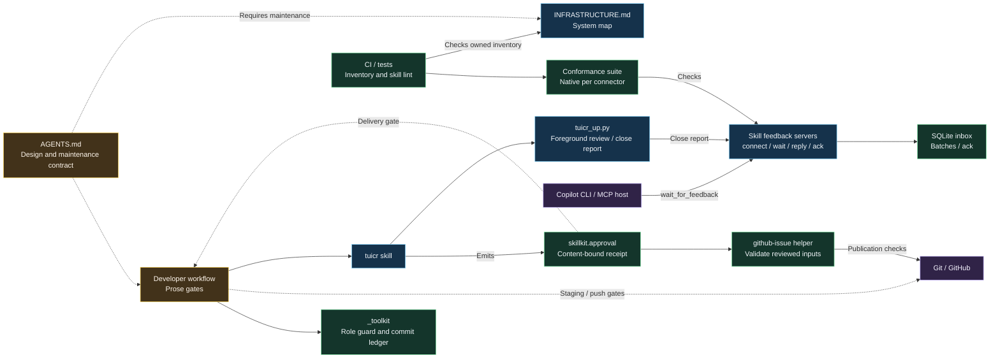

# Infrastructure megadrawing

System block view of the repository's skills, declared MCP servers, custom agents, and relevant external review surfaces.
This drawing describes the checked-out implementation; it is not a deployment inventory of installed plugins.

**Legend:** arrows show invocation or data flow; dashed arrows show prose workflow constraints, not executable enforcement.
Blue blocks are capabilities, green blocks executable checks, amber blocks policy, and purple blocks external applications.
Review skills own their feedback MCP servers; one shared contract in `skillkit.feedback` keeps them uniform. The `tmux` skill only manages panes; nothing injects keystrokes.

<!-- mermaid-review: infrastructure -->

mmdr keeps its own native MCP server in its repository; adopting the shared contract there is a follow-up.
Unconnected support skills are activated by their task triggers, not dependencies of the developer workflow.

## Policy and feedback loop

<!-- mermaid-review: policy-and-feedback -->

## Separation and enforcement

| Boundary | Owner and mechanism |
|---|---|
| Capability versus workflow | Skills own capabilities; custom agents compose them. This is a prose contract, not a runtime sandbox. |
| Shared implementation | `skills/_lib/skillkit` supplies primitives used by agents-md, git-commit, git-worktree, github-issue, presentation, skill-writer, tuicr, and `_toolkit`. It is a library, not a discoverable skill. |
| Review versus approval | Frontend closure is not general approval. tuicr emits `agents.approval/v1`; the issue helper verifies current inputs in code, while developer delivery gates remain agent instructions backed by helpers. |
| Work ownership | `_toolkit/role_guard.py` checks edits after dispatch; it is not a per-tool path sandbox. `_toolkit/ledger.py` gates commits on per-file authors and an approved close report. |
| Feedback servers versus workflow | Each review skill owns a stdio MCP server; `skillkit.feedback` enforces reply checks and durable delivery, and the shared conformance suite runs natively against every connector. SQLite retains observed changes and outstanding batches until acknowledgement; servers own no work execution, publication permission or idle-agent wake. |
| Native feedback semantics | mmdr uses message parents; presentation uses thread tails; tuicr infers answers by anchor/time. Connectors preserve these differences and expose the native `comment_type` hint. |
| Show after connect | The presentation server opens its tab on the agent's first wait, enforced in code. tuicr shows at once; comments made before the agent connects arrive in its first batch. |
| tuicr closure | `tuicr_up.py` deletes settled comments, keeping descriptions, review notes and unanswered comments, then writes the verdict report when its window exits; the tuicr server delivers it as the closure event, treating a session tuicr dropped once emptied as awaiting that report. Sessions opened otherwise report unknown closure. |
| End-to-end workflow | `tests/e2e/run_e2e.py` drives a fixture repo through brief, review rounds, commit and push with a scripted human in a private tmux server and XDG state, judged by a deterministic oracle and hidden acceptance test. CI runs a scripted agent on every PR and the developer agent on a live model nightly (`e2e-live.yml`). |
| Diagram maintenance | `tests/test_infrastructure_drawing.py` checks owned skill/agent/MCP node inventory. Humans audit relationship accuracy, design separation, and policy meaning. |

Standalone support skills remain task-triggered, not fabricated dependencies of every custom agent.
The external `mermaid-review` skill and mmdr package belong to the separate mmdr repository; built-in host tools and stale installed plugin versions are outside this repository's inventory.
`writer` has a standalone comparison helper; do not infer a shared-library dependency from group membership.

## Sources of truth

[Plugin registration](../plugin.json), [MCP configuration](../mcp.json), [skill contracts](../skills/), and [custom-agent contracts](../com.github.copilot/agents/) define the owned inventory and invocation rules.
[Shared feedback contract](../skills/_lib/skillkit/feedback.py), [conformance suite](../skills/_lib/skillkit/feedback_conformance.py), and [shared approval code](../skills/_lib/skillkit/approval.py) define the depicted mechanisms.
Update this drawing in the same change as infrastructure additions, removals, rewiring, or policy-enforcement changes; preserve stable node IDs for review comments.
